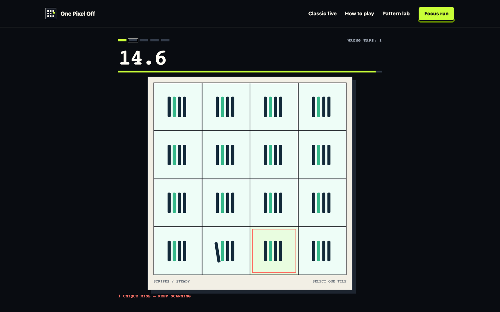
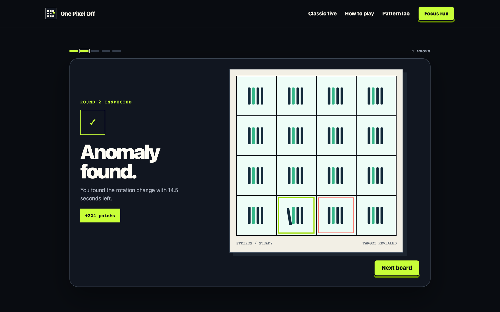
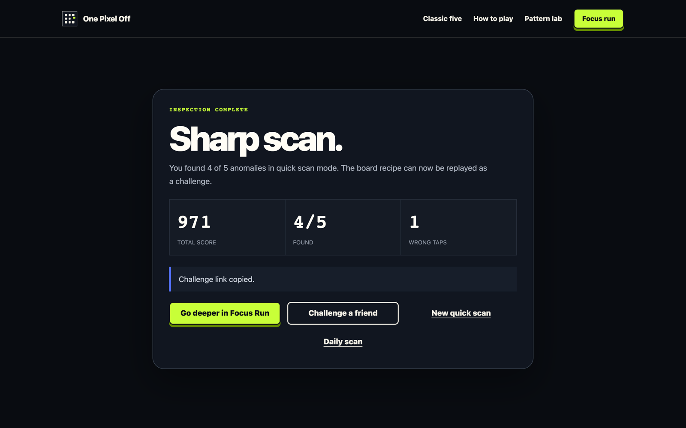
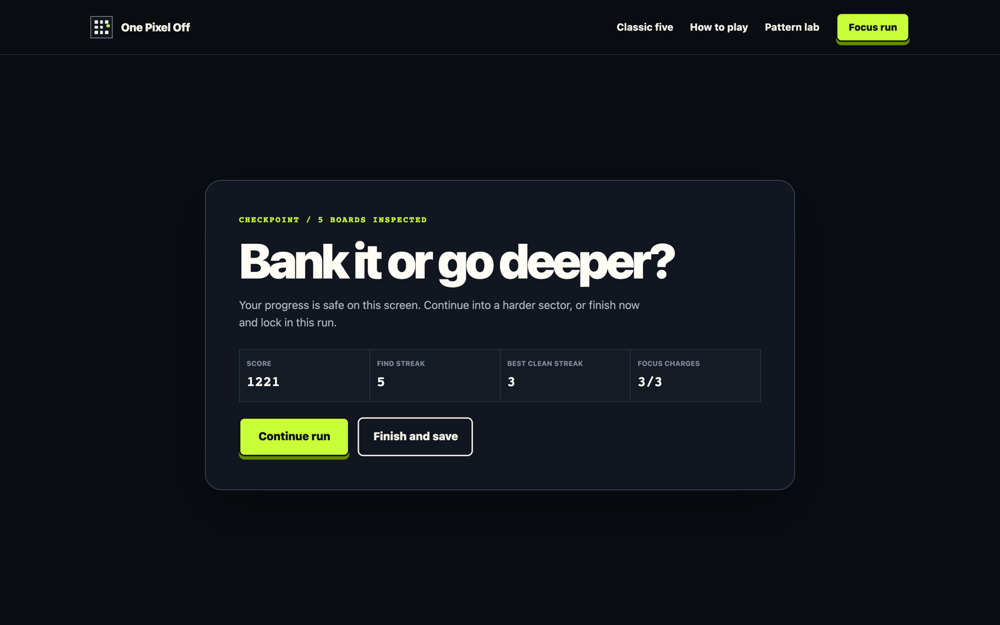
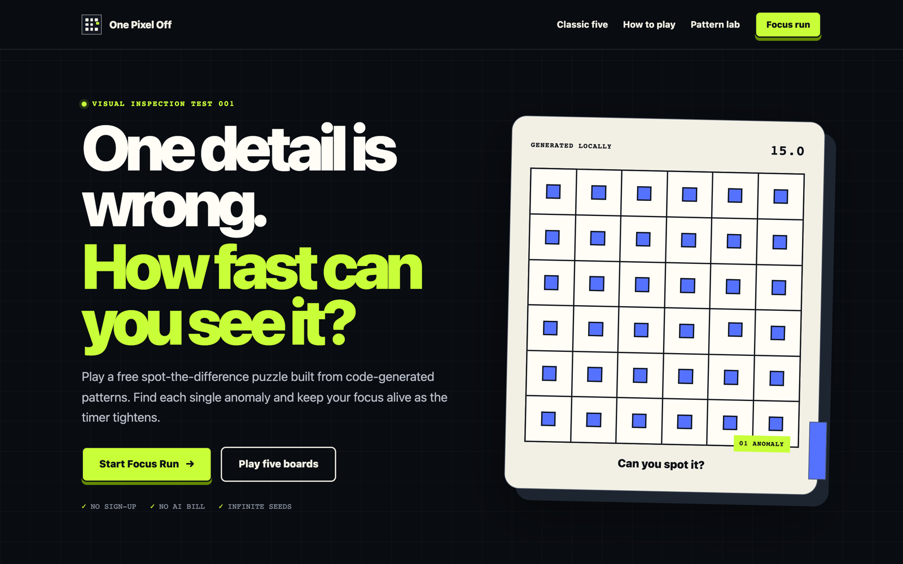
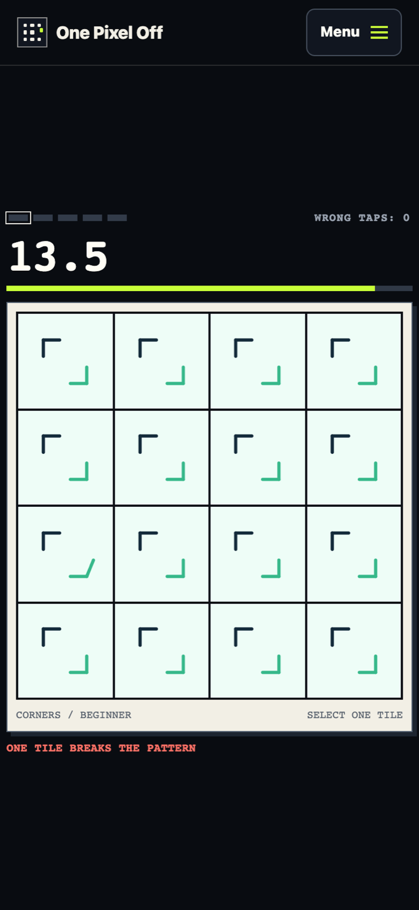

# One Pixel Off

**A visual-inspection game: one detail on the board is wrong — how fast can you see it?** No backend, no image-generation API: every board is generated deterministically from a seed.

**Source:** [fawaskoya/one-pixel-off](https://github.com/fawaskoya/one-pixel-off)

| | |
|---|---|
| **Role** | Solo: game design and engineering |
| **Stack** | Next.js 16 · React 19 · TypeScript · Tailwind 4 · Vitest — runtime deps are only next/react/react-dom |
| **Size** | ~9.7k lines of TS · 96 deterministic unit tests · 8 authored vector pattern families |

## How it works

- **Seeded generation.** A PRNG picks a pattern family (rings, stripes, arrows, corners, dots, diamonds, chevrons, orbit), palette, 4×4–6×6 grid, target cell and exactly one bounded mutation. The same seed always rebuilds the same boards — which is what makes the modes below possible without a server.
- **Daily Scan** derives its seed from the UTC date, so everyone gets the same five boards. **Weekly 15** uses the ISO week.
- **Challenge a friend** with a checksummed `/challenge/<token>` link; tampered tokens are rejected.
- **Focus Run:** three charges, a timer that tightens from 15 s to 12 s, a checkpoint every five boards (bank it or go deeper), and recovery mechanics.
- **Fair timing:** a pure reducer with phase tokens and absolute deadlines, so backgrounding the tab can't buy extra time. Score = 100 + speed bonus − 20 per wrong tile, clamped to 25–250.
- Versioned local stats with streaks and badges, keyboard grid navigation, installable PWA.

<table>
<tr>
<td width="50%"> Anomaly revealed with the earlier wrong tap.</td>
<td width="50%"> Scan report with a copyable challenge link.</td>
</tr>
<tr>
<td> Focus Run checkpoint: bank or go deeper.</td>
<td> Landing page with a live generated board.</td>
</tr>
</table>

## Recent quality pass (Oct 2026)

Fixed a broken fresh install (placeholder `pnpm-workspace.yaml`), a challenge-results navigation loop, and a layout seam — every mode verified end-to-end with Playwright. → [PR #2](https://github.com/fawaskoya/one-pixel-off/pull/2)
