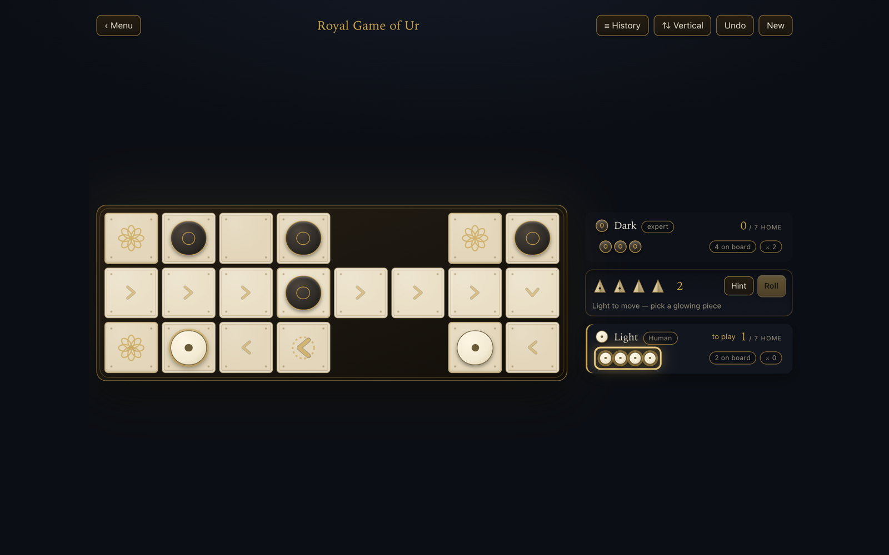
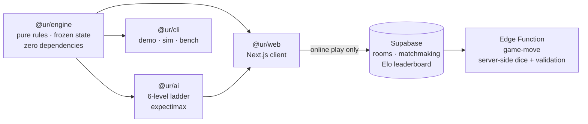
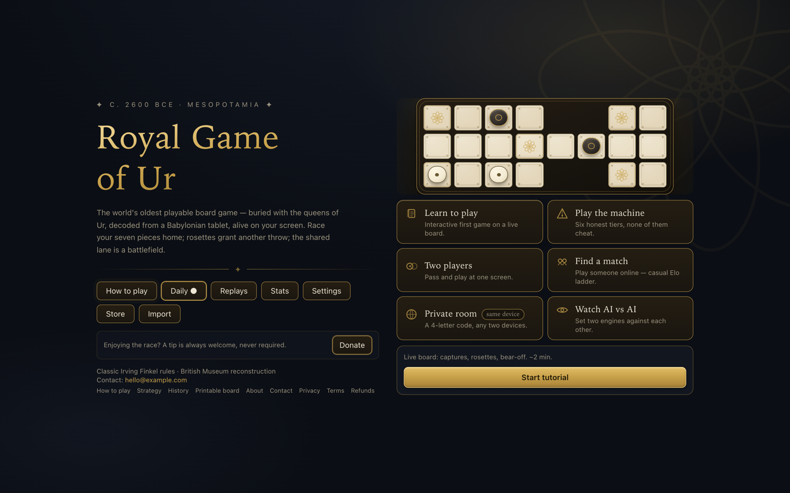
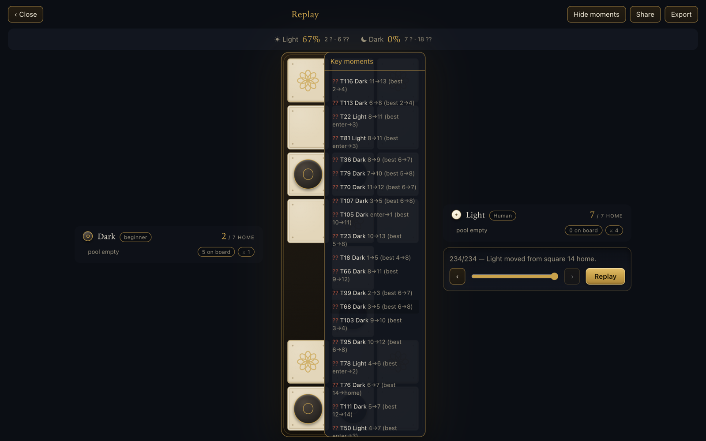
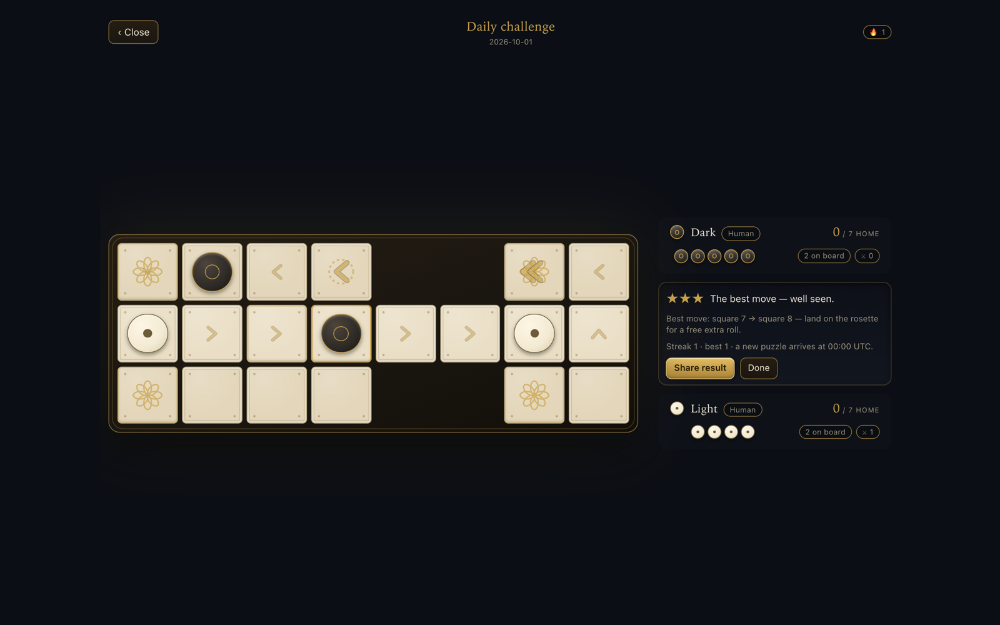
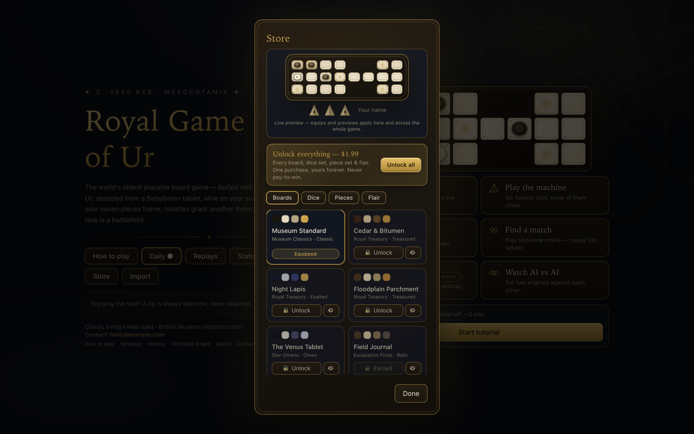
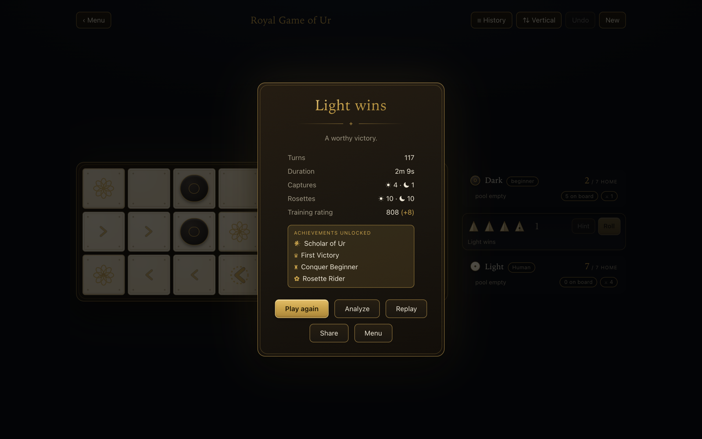
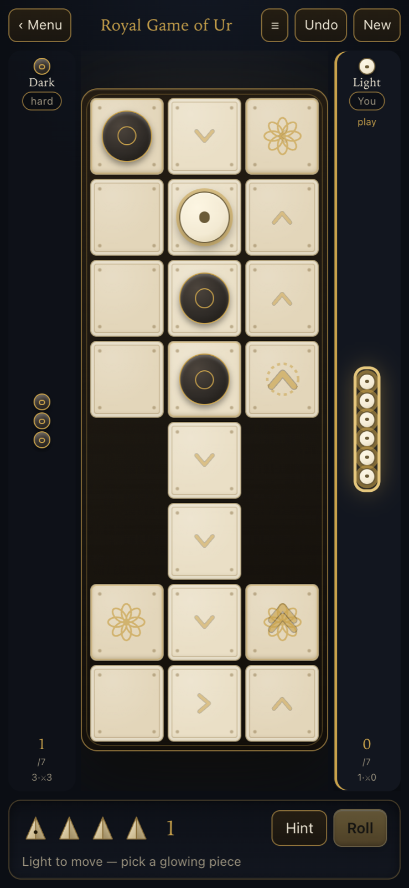
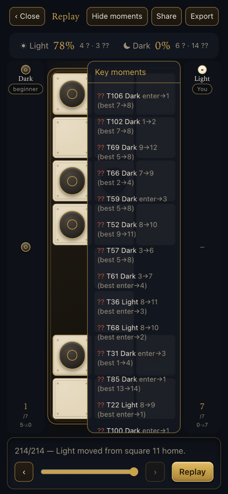

# Royal Game of Ur — flagship project

**The world's oldest playable board game (c. 2600 BCE), rebuilt as a modern web game:** historically grounded rules, an AI that never cheats, verified replays, a daily puzzle, online rooms and a cosmetics store.

**▶ Play:** [royalgameofur.app](https://royalgameofur.app) · **Source:** [fawaskoya/royal-game-of-ur](https://github.com/fawaskoya/royal-game-of-ur)

| | |
|---|---|
| **Role** | Solo: game design, engine, AI, web client, backend, payments, content |
| **Stack** | TypeScript monorepo · Next.js 15 · React 19 · Tailwind 4 · Framer Motion · Supabase (Postgres, Auth, Edge Function) · Vitest |
| **Size** | ~18.5k lines across 4 packages · 155 tests (engine 49 incl. fuzzing, AI 17, web 89) · 25 routes · 10 SQL migrations |

---

## Architecture

- **The engine is a pure function library.** State is frozen, dice are *inputs*, so the same events always reproduce the same game. Every replayed move is re-validated against the rules, and save/replay formats are versioned.
- **A whole game fits in a ~160-character URL** — 4 bits per throw, 3 bits per move — and is decoded *through the engine*, so a tampered link can't produce an illegal game.
- **Online play is server-authoritative:** dice are rolled and moves validated in an Edge Function, never trusted from the client. The Supabase client is only loaded when you go online; without a backend the app degrades cleanly to same-device rooms.

## An AI ladder that never cheats

Six levels, all choosing only from legal moves and never peeking at future dice:

| Level | How it plays |
|---|---|
| Beginner | random legal moves |
| Easy | heuristic evaluation, blunders 35% of the time |
| Medium | same heuristic, no blunders, no look-ahead |
| Hard | expectimax, 2 throws deep |
| Expert | expectimax, 3 throws deep |
| Master | expectimax, 4 throws deep, beam of 3, tuned weights |

Chance nodes weight each throw by its exact probability (0–4 pips: 1/4/6/4/1 out of 16). Measured: Hard beats Medium 28–12 over 40 games.

## Features

<table>
<tr>
<td width="50%"> Homepage with a self-playing attract board and six play modes.</td>
<td width="50%"> Post-game analysis: accuracy, blunders and key moments (played vs engine-best).</td>
</tr>
<tr>
<td> Daily challenge — the same seeded position for everyone, with streaks.</td>
<td> 26-step interactive tutorial on a live board.</td>
</tr>
<tr>
<td> Cosmetics store with live skin preview and a single $1.99 unlock.</td>
<td> End of game: stats, rating change and achievements (20 in total).</td>
</tr>
</table>

Also: private online rooms with 4-letter codes, global casual matchmaking, an Elo leaderboard, an opening coach for new players, a route overlay, share-a-game links, achievements derived from local data, and data-backed SEO content (how-to-play, strategy with the engine's own odds tables, history, printable board).

## Recent quality pass (Oct 2026)

A full playthrough audit with Playwright at desktop and phone sizes found and fixed a daily-challenge bug where entering a new piece couldn't be selected (on 9 of the next 60 puzzles that was the *best* move, making three stars impossible), plus five analysis/store layout issues. → [PR #3](https://github.com/fawaskoya/royal-game-of-ur/pull/3)

---

*Built by [Fawas Koya](https://github.com/fawaskoya).*
