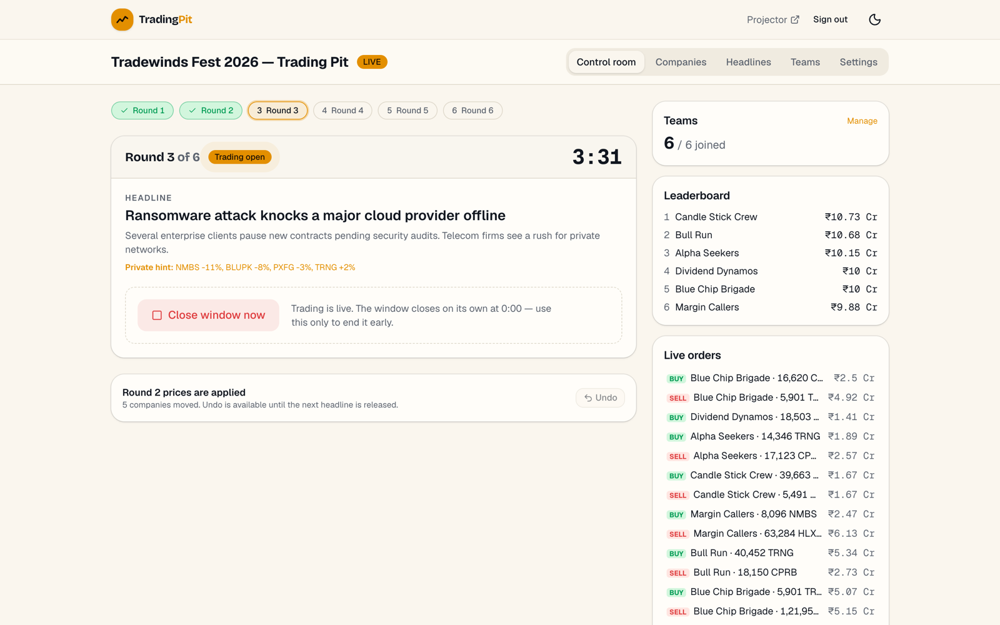
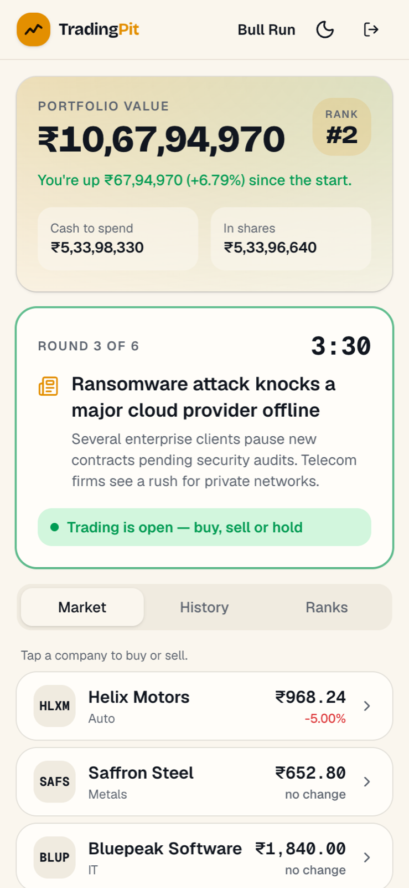
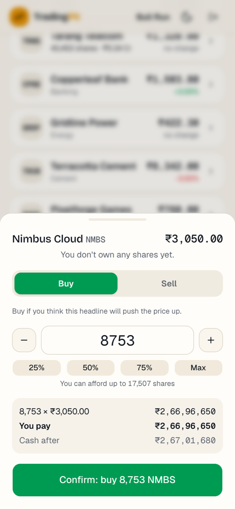
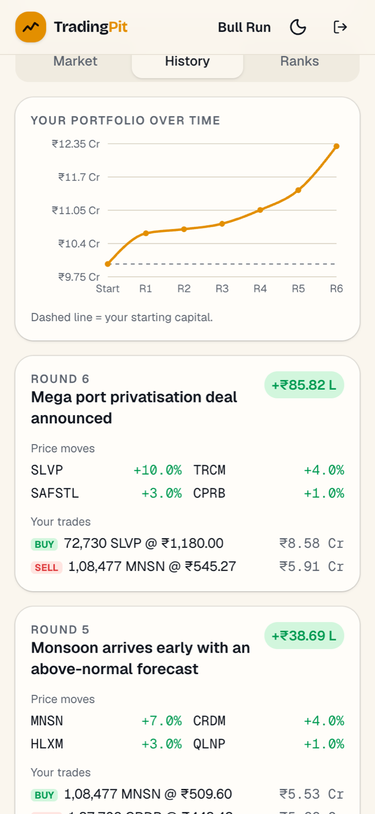
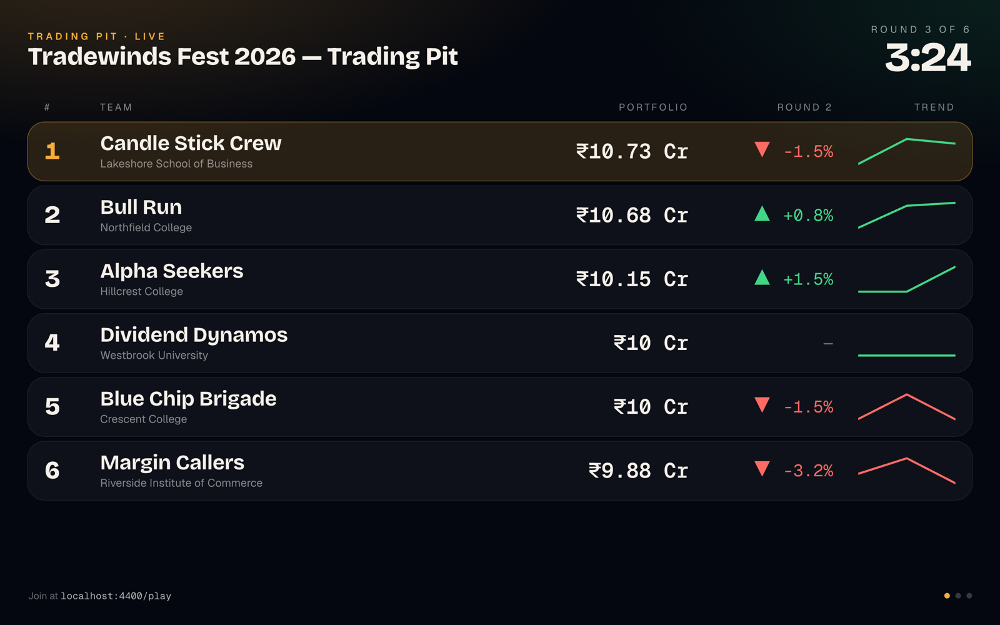
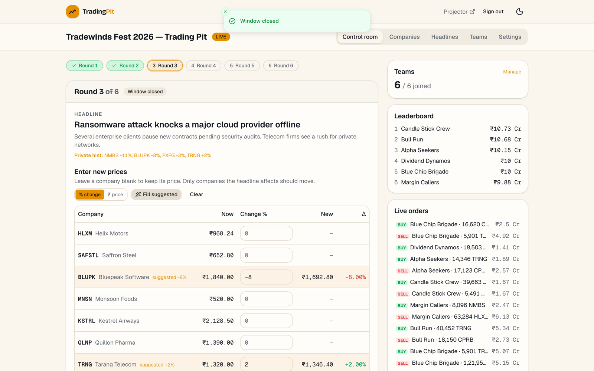
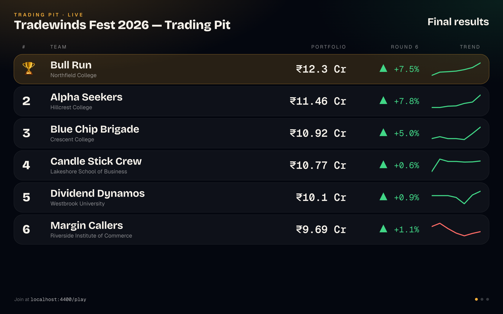

# Trading Pit

**A live stock-market simulation for college fests.** Teams trade from their phones, an organiser releases a news headline each round, prices move, and a projector shows the leaderboard to the room.

**Source:** [fawaskoya/trading-pit](https://github.com/fawaskoya/trading-pit)

| | |
|---|---|
| **Role** | Solo: product, database design, frontend |
| **Stack** | Next.js 15 · React 19 · TypeScript · Tailwind 4 · shadcn/ui · Supabase (Postgres, anonymous Auth, Realtime, RLS, pg_cron) · Recharts · Zod · Vercel |
| **Size** | 9 tables, 2 views, ~15 Postgres functions · ~4.7k lines of TS · 44 pgTAP database tests + Playwright e2e |

## The interesting part: the rules live in Postgres

Dozens of teams hammer "buy" in the last seconds of a round, so the trading rules can't live in the browser:

- **Every order is a database function** that locks the team's row, checks the deadline against the *server's* `now()`, and applies fees, position caps and optional shorting atomically.
- **A round state machine** (headline → open → close → apply prices → undo) with exactly one active round per event, enforced by a partial unique index.
- **Public views that leak nothing:** the leaderboard and equity curves are exposed through owner-privileged views that never reveal another team's cash or holdings; the organiser's price hints stay private.
- **Live without fragility:** Supabase Realtime pushes updates, with a polling fallback; countdowns are synced to server time.
- Teams join with a code on an anonymous, cookie-based session — no sign-up friction at a fest.

## Screens

<table>
<tr>
<td width="33%"> Team phone: rank, headline, live market.</td>
<td width="33%"> Trade drawer with cost breakdown.</td>
<td width="33%"> Equity curve across six rounds.</td>
</tr>
</table>

<table>
<tr>
<td width="50%"> Projector leaderboard with per-team sparklines.</td>
<td width="50%"> "Breaking" view when a headline is released.</td>
</tr>
<tr>
<td> Price editor pre-filled from the organiser's suggested moves.</td>
<td> Final results after round six.</td>
</tr>
</table>

## Recent quality pass (Oct 2026)

A six-round simulated game (organiser + six team phones + projector, driven by Playwright) found that screens treated "between rounds" as "game over", that changing starting capital after teams joined corrupted P&L, and that anonymous team sessions could create events directly. All fixed with a new guarded migration and six new database tests. → [PR #1](https://github.com/fawaskoya/trading-pit/pull/1)

*Screenshots use an invented event, companies and teams.*
